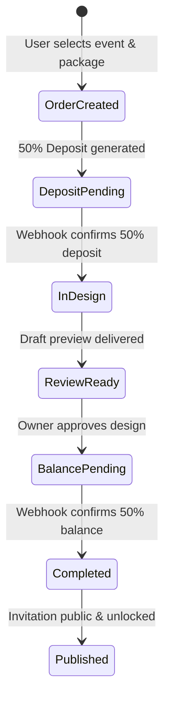

# Commercial Study: Payment Gateways for Mexico (Mercado Pago, Stripe, Conekta)

- **Date**: 2026-10-23
- **Author**: Agent Gemini (`pasarela-pago-estudio`)
- **Lane**: `f05-plataforma`
- **Context & Decision**: Decision `d148` (read-only architectural & commercial study for Mexican
  payment gateways)
- **Target Market**: Digital invitations & event celebration packages in Mexico (average ticket:
  $500 MXN – $2,500 MXN)

---

## 1. Executive Summary & Recommendation

Celebra-me is transitioning its landing page into an interactive showroom with discrete purchase
triggers and direct checkout for digital invitations (XV, Weddings, Baptisms, Birthdays).

For the Mexican consumer market, payment preferences differ significantly from US/European markets:

1. **Debit card & Mobile Banking dominance**: Over 65% of online transactions in this ticket range
   use debit cards (BBVA, Santander, Banorte, Nu, Mercado Pago, Banco Azteca).
2. **Cash convenience stores (OXXO Pay)**: Critical for a significant segment of event hosts who do
   not use credit cards or prefer cash deposits.
3. **Electronic transfers (SPEI)**: High trust, zero chargeback risk, instant settlement via CLABE.
4. **Deposit & Balance workflow (Anticipo / Liquidación)**: Clients typically pay 50% upfront to
   initiate invitation customization and the remaining 50% before final production / public
   deployment.

### Final Recommendation

| Tier                          | Gateway          | Role in Celebra-me          | Key Differentiator                                     |
| :---------------------------- | :--------------- | :-------------------------- | :----------------------------------------------------- |
| **Primary (Recommended)**     | **Mercado Pago** | Default checkout for Mexico | Highest Mexican adoption, OXXO Pay + SPEI, fee refunds |
| **Secondary (Complementary)** | **Stripe**       | Premium card checkout       | Apple Pay / Google Pay, native Cloudflare Workers SDK  |
| **Alternative**               | **Conekta**      | Reference only              | Traditional Mexican cash network, legacy integration   |

#### Detailed Gateway Evaluation:

- **Mercado Pago (Primary)**: Highest consumer familiarity in Mexico, integrated OXXO Pay + SPEI,
  installment payments via Mercado Crédito without merchant financing risk, and **refunds return
  gateway processing fees**.
- **Stripe (Secondary)**: Best-in-class developer experience, seamless Apple Pay & Google Pay
  (1-touch checkout), native Cloudflare Workers compatibility. Higher cost for refunds (fees not
  returned) and international cards.
- **Conekta (Alternative)**: Solid Mexican cash network, but more bureaucratic onboarding, legacy
  SDKs, and lacks consumer credit features.

---

## 2. Gateway Comparison Matrix

| Criteria                                 | Mercado Pago (Checkout Pro / Bricks)                                                                          | Stripe (Checkout / Elements)                                            | Conekta                                               |
| :--------------------------------------- | :------------------------------------------------------------------------------------------------------------ | :---------------------------------------------------------------------- | :---------------------------------------------------- |
| **Credit & Debit Cards (National)**      | **3.49% + $4.00 MXN + VAT** (instant)<br>3.15% + $4.00 MXN + VAT (14-day)<br>2.95% + $4.00 MXN + VAT (30-day) | **3.60% + $3.00 MXN + VAT**                                             | 2.90% – 3.40% + $2.50 – $3.00 MXN + VAT               |
| **American Express (AMEX)**              | Same national rate                                                                                            | Same national rate                                                      | Supported (same or +0.5%)                             |
| **International Cards**                  | +0.50% to +1.00%                                                                                              | +1.50% (+1.00% currency conversion)                                     | +1.50%                                                |
| **Cash at OXXO (OXXO Pay)**              | **3.49% + $4.00 MXN + VAT**<br>Buyer pays ~$15–$17 MXN fee at counter                                         | **$12.00 MXN flat or 3.4% + $3.00 MXN + VAT**<br>Buyer pays counter fee | **3.90% + $3.00 MXN + VAT**<br>Buyer pays counter fee |
| **SPEI (Bank Transfer)**                 | Integrated STP / SPEI via virtual CLABE                                                                       | **$15.00 MXN flat + VAT** per transfer                                  | **$8.00 MXN flat + VAT** per transfer                 |
| **Fee Retention on Refunds**             | **Fees are refunded** proportionally                                                                          | **FEES ARE NOT REFUNDED** (Merchant absorbs fee)                        | Fees are not refunded                                 |
| **Installments (MSI / Consumer Credit)** | Native **Mercado Crédito** (no merchant risk) + traditional bank MSI                                          | Traditional bank MSI with merchant surcharges (4.5%–14.5%)              | Traditional bank MSI                                  |
| **Payout Timeline (Bank Deposit)**       | Instant, 14 days, or 30 days                                                                                  | T+2 business days (rolling)                                             | T+2 to T+3 business days                              |
| **Chargeback Protection (3DS 2.0)**      | High (Mercado Libre anti-fraud engine)                                                                        | Stripe Radar with Machine Learning                                      | Conekta Shield                                        |
| **Cloudflare Workers Compatibility**     | REST API via standard `fetch`                                                                                 | First-class `stripe` SDK with fetch transport                           | REST API via `fetch`                                  |

---

## 3. Deep-Dive Analysis by Operational Category

### 3.1 Fee Impact by Ticket Size

Assuming standard digital invitation price points in Mexico:

#### Scenario A: Basic Invitation Package ($799 MXN)

- **Mercado Pago** (instant):
  - Fee: `($799 * 3.49%) + $4.00` = $27.89 + $4.00 = $31.89 MXN (+ 16% VAT on fee: $5.10) = **$36.99
    MXN** (4.63% effective rate).
  - Net to Celebra-me: **$762.01 MXN**.
- **Stripe**:
  - Fee: `($799 * 3.60%) + $3.00` = $28.76 + $3.00 = $31.76 MXN (+ 16% VAT on fee: $5.08) = **$36.84
    MXN** (4.61% effective rate).
  - Net to Celebra-me: **$762.16 MXN**.
- **Cost difference**: Negligible (~$0.15 MXN per transaction).

#### Scenario B: Premium Custom Package ($1,899 MXN)

- **Mercado Pago** (instant): Fee $70.28 + $4.00 = $74.28 (+ VAT: $11.88) = **$86.16 MXN** (4.54%
  effective rate).
- **Stripe**: Fee $68.36 + $3.00 = $71.36 (+ VAT: $11.42) = **$82.78 MXN** (4.36% effective rate).
- **Cost difference**: ~$3.38 MXN.

---

### 3.2 OXXO Pay & SPEI Workflow in Mexico

Digital invitations are frequently purchased by family members or event organizers without
international credit cards.

1. **OXXO Pay Mechanics**:
   - The buyer receives a 14-digit numeric reference and a dynamic barcode on screen, sent via
     WhatsApp/SMS.
   - The buyer pays cash at any OXXO counter in Mexico.
   - OXXO sends an immediate webhook notification to Celebra-me upon transaction completion
     (typically under 2 minutes).
   - Expiration window should be configurable (e.g., 48 hours for deposits).
2. **SPEI Mechanics**:
   - Both Stripe and Mercado Pago generate unique 18-digit virtual CLABEs per purchase order.
   - Client transfers from their banking app (BBVA, Nu, Banorte, Hey Banco).
   - Real-time reconciliation: webhook triggers immediately with exact amount match.
   - **Advantage**: Zero chargeback risk; funds cannot be reversed fraudulently once transferred.

---

### 3.3 The Deposit (Anticipo) & Balance (Liquidación) Workflow

Celebra-me operates on custom design and digital delivery. A single full charge is often a barrier
to conversion.

#### Recommended 2-Stage Order Lifecycle:



1. **Deposit (50%)**: Triggers automated provisioning of draft slug and WhatsApp notification to the
   production queue.
2. **Balance (50%)**: Released via a direct link (`/checkout/balance/[orderId]`) sent to the client
   once the preview is reviewed and approved. Final publication and custom domain / DNS routing are
   conditioned on balance settlement.

---

### 3.4 Mexican Tax (SAT) & Invoicing (CFDI 4.0)

#### Regulatory Status:

- Under Mexican tax law (Art. 113-A and 113-B of LISR), payment aggregators act as tax withholding
  agents for individuals (Personas Físicas) providing services or digital goods:
  - **Persona Moral (Company)**: Exempt from platform tax withholdings. The gateway transfers gross
    sales minus gateway fee and provides a monthly digital tax receipt (CFDI) for the deducted
    processing fees.
  - **Persona Física (Sole Proprietor)**: If registered under _Régimen de Plataformas Tecnológicas_
    or _Actividades Empresariales_, the gateway withholds 1% to 2.5% ISR and 8% VAT (half of the 16%
    VAT) if a valid RFC is registered. If no RFC is registered, the penalty withholding is 20% ISR
    and 16% VAT.

#### Automatic Invoicing:

- For clients requesting a tax invoice (CFDI 4.0 con uso de CFDI `G03` o `S01`), Celebra-me can
  integrate an automated PAC service (e.g., Facturapi or Finkok) listening to the gateway's
  `payment.success` webhook.

---

### 3.5 Refund & Dispute Policy (Contracargos)

- **Mercado Pago Advantage**:
  - When an order is cancelled or refunded before production starts, Mercado Pago **reimburses the
    processing fees** to the merchant account.
  - Mercado Pago provides automatic buyer dispute arbitration.
- **Stripe Risk**:
  - Stripe **retains processing fees on all refunds**. Refunding a $1,500 MXN payment costs
    Celebra-me ~$66 MXN out of pocket.
  - Stricter on dispute evidence: requires formalized signed contracts or digital delivery
    timestamps.

---

## 4. Technical Architecture for Celebra-me

### 4.1 Integration Pattern: Decoupled Payment Intent

Do not couple the frontend directly to a single vendor SDK. Use a gateway-agnostic database model in
Supabase:

```sql
-- Conceptual schema in Supabase
CREATE TABLE public.commercial_orders (
    id UUID PRIMARY KEY DEFAULT gen_random_uuid(),
    event_type TEXT NOT NULL,
    invitation_slug TEXT,
    client_name TEXT NOT NULL,
    client_phone TEXT NOT NULL,
    client_email TEXT,
    package_id TEXT NOT NULL,
    total_amount_cents INT NOT NULL,
    deposit_amount_cents INT NOT NULL,
    balance_amount_cents INT NOT NULL,
    status TEXT NOT NULL DEFAULT 'draft', -- draft, deposit_pending, in_design, balance_pending, completed, refunded
    created_at TIMESTAMPTZ NOT NULL DEFAULT now()
);

CREATE TABLE public.commercial_transactions (
    id UUID PRIMARY KEY DEFAULT gen_random_uuid(),
    order_id UUID NOT NULL REFERENCES public.commercial_orders(id),
    stage TEXT NOT NULL, -- deposit, balance, full
    gateway TEXT NOT NULL, -- mercadopago, stripe
    gateway_transaction_id TEXT NOT NULL UNIQUE,
    payment_method TEXT NOT NULL, -- card, oxxo, spei
    amount_cents INT NOT NULL,
    fee_cents INT,
    status TEXT NOT NULL, -- pending, approved, rejected, refunded
    raw_payload JSONB,
    paid_at TIMESTAMPTZ,
    created_at TIMESTAMPTZ NOT NULL DEFAULT now()
);
```

### 4.2 Webhook Handling in Cloudflare Workers

- Webhook endpoint: `/api/commercial/webhooks/mercadopago` and `/api/commercial/webhooks/stripe`.
- Validate HMAC-SHA256 signature on raw request body before parsing JSON.
- Enforce idempotency: check if `gateway_transaction_id` is already marked `approved` before
  triggering internal state transitions.
- Asynchronous notification: upon successful payment, emit an internal operational notification (via
  WhatsApp API or dashboard activity feed).

---

## 5. Next Steps & Implementation Roadmap

1. **Phase 1 (Commercial Definition)**:
   - Owner selection between **Mercado Pago Checkout Pro** (fastest launch, maximum Mexican trust,
     OXXO/SPEI included) and **Stripe Checkout** (cleanest minimalist card UI).
   - Confirmation of legal/tax entity status (Persona Moral vs Persona Física) to configure RFC and
     withholding profiles.
2. **Phase 2 (Data Schema & Orders API)**:
   - Migration in Supabase for `commercial_orders` and `commercial_transactions`.
   - API route for order creation and webhook verification.
3. **Phase 3 (Showroom Integration)**:
   - Connect the new landing showcase buttons ("Apartar fecha", "Comprar diseño") to generate the
     50% deposit checkout link.
